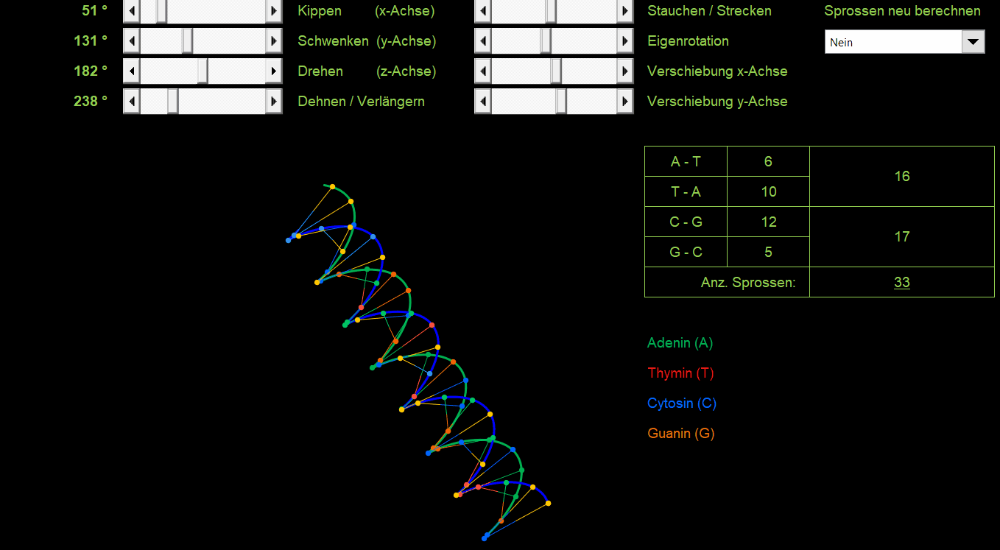

#### Interaktive 3D-Doppelhelix in Excel (XY-Punktdiagramm)

Dieses Projekt enthält ein interaktives Excel-Modell, das eine mathematisch präzise Doppelhelix mit mehrfarbigen Sprossen in einem standardmäßigen 2D-XY-Punktdiagramm dreidimensional visualisiert. Das Modell funktioniert rein über native Excel-Formeln und benötigt keinerlei VBA oder Makros. 

#### Features

* **3D-Rotation im Raum:** Drehung der Helix über globale Rotationsmatrizen (Winkel Alpha, Beta, Gamma).
* **Lokale Eigenrotation:** Vollständige Drehung der Helix um ihre eigene mittlere Längsachse (Delta-Winkel), unabhängig von der Neigung im Raum.
* **Dynamische Verschiebung:** Zwei integrierte Schieberegler (Formularsteuerelemente) ermöglichen das stufenlose Verschieben des Modells auf der X- und Y-Achse des Diagramms.
* **Mehrfarbige Sprossen:** Anschauliche und übersichtliche Darstellung der Verbindungen zwischen den Strängen.
* **Kein VBA:** Maximale Kompatibilität und Sicherheit, da das Modell ausschließlich auf Standard-Formeln (wie SIN, COS, Matrix-Transformationen) basiert.

#### Bedienung

1. **Globale Drehung:** Ändere die Werte der Winkel in den vorgesehenen Eingabezellen, um die Helix im dreidimensionalen Raum zu kippen.
2. **Eigenrotation:** Passe den Delta-Winkel an, um die Helix um ihre eigene Achse wirbeln zu lassen.
3. **Verschiebung:** Nutze die beiden Schieberegler neben dem Diagramm, um die Helix nach links/rechts oder oben/unten zu bewegen.

#### Blattschutz / Bearbeitung

Um die komplexen mathematischen Formeln und Verknüpfungen vor unbeabsichtigten Veränderungen zu schützen, sind die Tabellenblätter gesperrt. 

* Das Kennwort zum Aufheben des Blattschutzes lautet: **xx**
* Du kannst den Schutz jederzeit in Excel unter dem Reiter *Überprüfen* -> *Blattschutz aufheben* entfernen, wenn du einen Blick in die Formelstrukturen werfen oder das Modell erweitern möchtest.

#### Lizenz

Dieses Projekt steht unter der **MIT-Lizenz**. Das bedeutet, du kannst das Modell frei verwenden, modifizieren und teilen. Details findest du in der beigefügten LICENSE-Datei.
